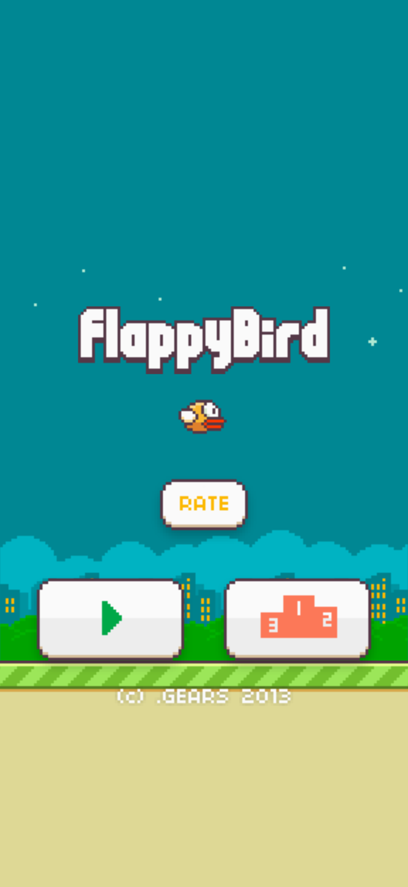
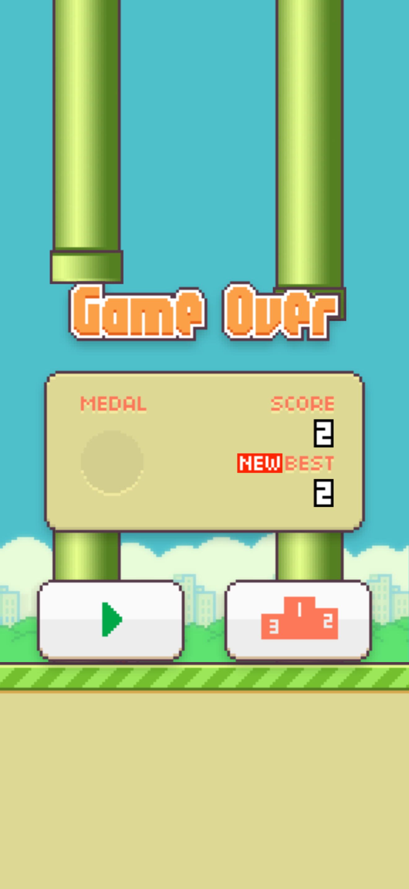
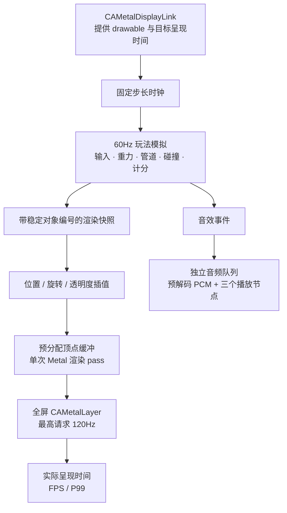

<div align="center">
  

# Flappy Bird · iOS 120Hz

**把 Flappy Bird 1.2 带到现代 iPhone：原版像素画面与音效，原生 Metal，全屏适配，最高 120Hz 渲染。**

Native Objective-C++ / Metal revival of Flappy Bird 1.2 for modern iPhones.

[](https://github.com/Pingfan1337/FlappyBird-iOS-120Hz/actions/workflows/build.yml)


[下载最新 IPA](https://github.com/Pingfan1337/FlappyBird-iOS-120Hz/releases/latest) · [安装方法](#安装) · [从源码构建](#从源码构建) · [流畅度改造](#流畅度改造) · [已知限制](#已知限制)

</div>

## 画面预览

<table>
  <tr>
    <td align="center"><br /><b>菜单</b></td>
    <td align="center"><br /><b>准备起飞</b></td>
  </tr>
  <tr>
    <td align="center"><br /><b>游戏中</b></td>
    <td align="center"><br /><b>结算</b></td>
  </tr>
</table>

以上图片由仓库中的**同一套游戏逻辑、Metal 着色器与渲染几何**在 Mac GPU 上离屏生成，使用实际模拟状态；游戏画面由自动输入推进。图片不含 iPhone 的动态岛、系统手势条与原生 FPS 标签，也不作为真机帧率证明。可用 `python3 scripts/previews.py` 重新生成。

## 项目简介

这是一次从旧版 32 位应用到现代 arm64 原生应用的非官方迁移。以 Flappy Bird **1.2** 的资源和可分析程序为依据，重建玩法逻辑，并用现代 Apple 框架实现显示、音频与系统入口。

项目经过了几轮真机反馈：先打通启动和签名安装，再修复全屏黑边、地面遮挡、顶部高度限制，最后处理“FPS 很高，运动却仍有顿挫”的问题。当前公开版本是这条迭代链的 **12005** 构建。

项目作者在 **iPhone 17 Pro Max / iOS 27** 环境确认可运行，并反馈最新版的流畅度显著改善。其他设备、系统与使用条件尚需验证。

### 当前功能

| 功能 | 实现情况 |
|---|---|
| 原版素材 | 原始图集、图集索引、五个音效；构建前逐文件校验 SHA-256 |
| 游戏流程 | 菜单、准备、点击飞行、管道、碰撞、计分、死亡、结算与重开 |
| 成绩 | 本地最高分与原版奖牌门槛 |
| 设备架构 | arm64，最低 iOS 17 |
| 显示 | Metal 原生分辨率绘制，最高请求 120Hz |
| 玩法模拟 | 固定每秒 60 次；显示刷新率变化不会让游戏加速 |
| 全屏适配 | 等比保留核心区域，上下延伸天空和地面 |
| 顶部飞行 | 可完全飞出视野；有限上升，自然回落后可再次起跳 |
| 音频 | 启动时预解码，独立队列调度三个播放节点 |
| 性能读数 | 实际呈现 FPS 与 P99 帧间隔，双指双击隐藏或显示 |

## 安装

### 下载 Release

1. 打开 [Releases](https://github.com/Pingfan1337/FlappyBird-iOS-120Hz/releases/latest)。
2. 下载 `FlappyBird-1.2-Metal-smooth-unsigned.ipa`。
3. 将文件传到 iPhone，用自己的有效证书和描述文件重新签名；项目作者使用轻松签完成真机安装。
4. 按签名工具和 iOS 的提示完成安装，打开 **Flappy Bird**。

**Release 中的 IPA 未签名。** 仓库和发布包不包含证书、私钥或描述文件；直接下载不会自动完成签名安装。

需要校验下载文件时，可使用 Release 附带的 `SHA256SUMS.txt`：

```bash
shasum -a 256 -c SHA256SUMS.txt
```

### 操作

- 点击开始按钮进入准备状态，再点击屏幕起飞。
- 游戏中点击屏幕让小鸟上升。
- 死亡后等待结算，点击开始按钮重开。
- **双指双击**切换右上角 FPS / P99 标签。

### 关于 120Hz

“最高 120Hz”是应用的渲染请求，实际刷新率由系统、显示器和运行状态共同决定。[Apple 的 ProMotion 说明](https://developer.apple.com/documentation/quartzcore/optimizing-iphone-and-ipad-apps-to-support-promotion-displays)也明确区分了帧率偏好与最终调度。

标签里的 FPS 来自 drawable 的实际呈现回调。**P99** 是最近最多 256 个已呈现帧间隔的 99 分位数，单位为毫秒。稳定 120Hz 的帧间隔约为 **8.33ms**；观察 P99 能发现平均 FPS 掩盖的偶发长帧。前台恢复后会重新统计。

## 从源码构建

### 环境

- macOS。
- 完整 Xcode，且已接受许可、安装 iPhoneOS SDK。
- 支持 iOS 17 API 的工具链。
- Python 3。

**不需要下载 iOS 模拟器运行时，也不需要安装第三方 Python 包。** 构建脚本直接使用 Xcode 的 clang、iPhoneOS SDK 和系统框架。

```bash
git clone https://github.com/Pingfan1337/FlappyBird-iOS-120Hz.git
cd FlappyBird-iOS-120Hz

# 确认设备 SDK
xcrun --sdk iphoneos --show-sdk-path

# 执行主机回归检查
python3 scripts/test.py

# 构建 arm64 未签名 IPA
python3 scripts/build.py
```

生成结果：

```text
dist/
├── FlappyBird-1.2-Metal-smooth-unsigned.ipa
└── SHA256SUMS.txt
```

默认中间产物放在 `build/device/`，可用 `FLAPPY_BUILD_DIR` 指定其他构建目录。`build/` 和 `dist/` 已加入 `.gitignore`。当前工程使用脚本构建，无需打开 `.xcodeproj`。

构建脚本会验证 `resources/sha256.json`，保留竖屏、arm64/Metal 能力要求、原生 Scene 生命周期及 ProMotion 配置。最终签名由使用者完成。

### 重新生成文档配图

```bash
python3 scripts/previews.py
```

这一步需要可用的本机 Metal GPU，会更新 `docs/images/` 中的四张 PNG；它不启动模拟器，也不录制手机屏幕。

## 流畅度改造

### 为什么 FPS 很高也可能不顺滑？

平均帧率只能说明一段时间内呈现了多少帧。物体在相邻帧之间匹配错误、位移不连续，或者呈现间隔不均匀，都可能造成顿挫。

项目中曾复现一个具体问题：管道队列循环后，插值按同名精灵在列表里的“第几个”匹配上一帧；同一根管道会被匹配到别的对象。一次 120Hz 中间帧测试中，期望横坐标为 `104`，旧代码绘制为 `103`，造成 **1 个逻辑像素的跳变**。

修复后的每对管道有持续不变的对象编号。队列循环时保留存活对象的编号，同时保留第三对屏幕外管道的渲染快照，让进入视口的运动也可以连续插值。

| 检查 | 修复前 | 当前版本 |
|---|---:|---:|
| 指定管道循环中间帧 | `x = 103` | `x = 104` |
| 该帧期望位置 | `x = 104` | `x = 104` |
| 该帧位置误差 | `−1 px` | `0 px` |
| 连续运动检查 | — | 固定与变刷新率各 4000 帧 |

8000 帧测试中的最大位置误差约为 `1.14e-10` 个逻辑像素。这是对应测试轨迹的结果，不能直接推导为所有真机场景都没有卡顿。

### 当前链路



关键改动：

- **Metal 专用调度**：`CAMetalDisplayLink` 直接提供 drawable，动画时钟使用 `targetPresentationTimestamp`；GPU 命令提交后按其合同调用 `present()`。[呈现 API 文档](https://developer.apple.com/documentation/quartzcore/cametaldisplaylinkdelegate/metaldisplaylink(_:needsupdate:))
- **原生分辨率**：直接绘制到屏幕 drawable，避免新增插值帧被低分辨率中间画布重新量化。
- **缓冲复用**：三个预分配顶点缓冲、一个渲染 pass，显示回调不等待 GPU 完成。
- **稳定对象身份**：管道循环和小鸟换翼帧不会中断运动插值。
- **独立音频调度**：五个音效预解码为统一的 44.1kHz 双声道 float PCM，经三个 `AVAudioEngine` 播放节点调度。显示线程不再执行音效文件进度复位。[音频节点文档](https://developer.apple.com/documentation/avfaudio/avaudioplayernode)
- **可观测性**：统计真实呈现时间的 FPS / P99，帮助区分平均帧率与帧间隔稳定性。

### 保留的玩法与有意适配的部分

| 项目 | 当前逻辑 |
|---|---|
| 核心画布 | 288 × 512 逻辑坐标 |
| 小鸟碰撞框 | 20 × 20 |
| 起跳速度 | `−5.0f` / 模拟 tick |
| 起跳后重力 | `0.3f` / 模拟 tick |
| 下降速度上限 | `8.0f` / 模拟 tick |
| 地面边界 | 核心坐标 `y = 400` |
| 管道宽度 / 间隙 | 52 / 96 |
| 管道移动 | 每模拟 tick 2 个逻辑像素 |
| 奖牌门槛 | 10 / 20 / 30 / 40 分 |

全屏版保留核心区域的比例，并延伸天空和地面。顶部起跳截止线按实际视野上边界重新计算，小鸟可以完整飞出屏幕，在有限上升后自然回落；上管道的轴和碰撞范围随之向上延伸。地面以原有前景顺序遮住下方管道。

这些是面向现代屏幕的适配。项目仍在还原和验证中，不宣称与原版逐像素、逐帧完全等价。

## 测试与验证

```bash
python3 scripts/test.py
```

当前回归覆盖：

| 测试 | 主要内容 |
|---|---|
| `OriginalBirdChecks` | 起跳轨迹、整数截断、旋转、落地与碰撞边界 |
| `OriginalGameChecks` | 菜单 → 准备 → 飞行 → 死亡 → 结算 |
| `PresentationChecks` | 不同刷新率下模拟一致性、插值、换翼、地面循环、触摸映射与遮挡 |
| `FlightCeilingChecks` | 完整飞出视野、有限上升、自然回落、重开与上管道防绕行 |
| `MotionContinuityChecks` | 8000 帧管道连续位移与 FPS / P99 统计 |
| `AudioDecodeChecks` | 五个原始音效的加载、PCM 格式、声道及非零音频能量 |

发布前另做了 arm64 编译、IPA 完整性、原资源哈希检查，以及桌面 GPU 离屏画面和地面遮挡像素检查。

主机测试和离屏渲染不能替代真机验证。当前真机反馈来自项目作者的使用体验，尚无覆盖所有设备、温控、音频路由与长时间运行场景的测试报告。

GitHub Actions 会执行主机回归和未签名 IPA 构建，不在 CI 中运行 GPU 配图脚本。

## 目录

```text
.
├── src/
│   ├── App/       # Scene 入口、Metal 呈现、几何、着色器、音频
│   └── Core/      # 玩法、固定步长、插值、布局和帧间隔统计
├── resources/     # 原版图集、音效、图标和 SHA-256 清单
├── tests/         # 主机回归检查
├── scripts/       # 构建、测试和 GPU 配图脚本
├── docs/images/   # 实际渲染器生成的文档配图
├── CHANGELOG.md
└── NOTICE.md
```

## 已知限制

- **Game Center**：原开发者的排行榜无法通过本项目的独立签名身份接入；点击排行榜会说明当前限制。
- **广告与商店链接**：原广告服务没有迁移；商店按钮仍指向原应用链接，其可用性不由本项目保证。
- **还原细节**：奖牌闪烁粒子尚未完成；现代渲染器与旧版多级缩放的逐像素采样可能不同。
- **帧率**：最高请求 120Hz，系统最终呈现频率仍可能变化。
- **设备覆盖**：主要真机反馈来自 iPhone 17 Pro Max，其他机型需要更多验证。

## 反馈问题

欢迎通过 [Issues](https://github.com/Pingfan1337/FlappyBird-iOS-120Hz/issues) 提交问题。建议附上：

- iPhone 型号、iOS 版本、应用构建号。
- 从启动到问题出现的复现步骤。
- 相关截图或录屏；涉及顿挫时附上 FPS / P99 读数。
- 是否与某个动作、场景切换、前后台切换或音频路由有关。

请勿在 Issue 中上传证书、密码、私钥或描述文件。

## 致谢与权利说明

原版游戏、像素画面、音效和相关品牌归原权利人所有，向 [.GEARS / DOTGEARS](https://dotgears.com/) 致谢。本项目为非官方迁移，与原开发者或 Apple 没有关联。

公开仓库不等于授予原版素材或重建代码新的使用许可。本项目没有将原版资源置于 MIT、Apache 或公有领域；具体范围见 [NOTICE.md](NOTICE.md)。

仓库不包含原始 App Store IPA、购买元数据、个人路径、签名材料或私人 IDA 数据库。Release 提供的是重建后的 arm64 应用。
