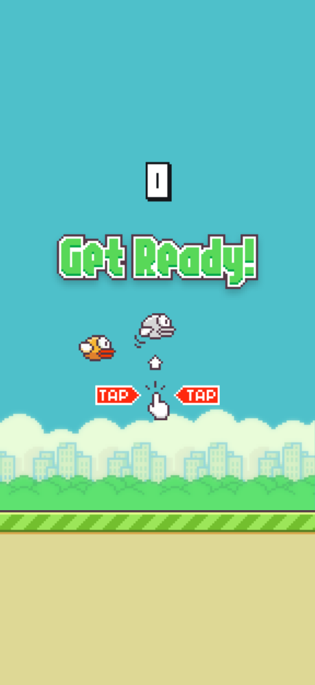
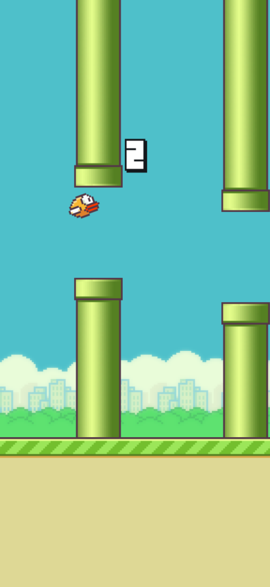
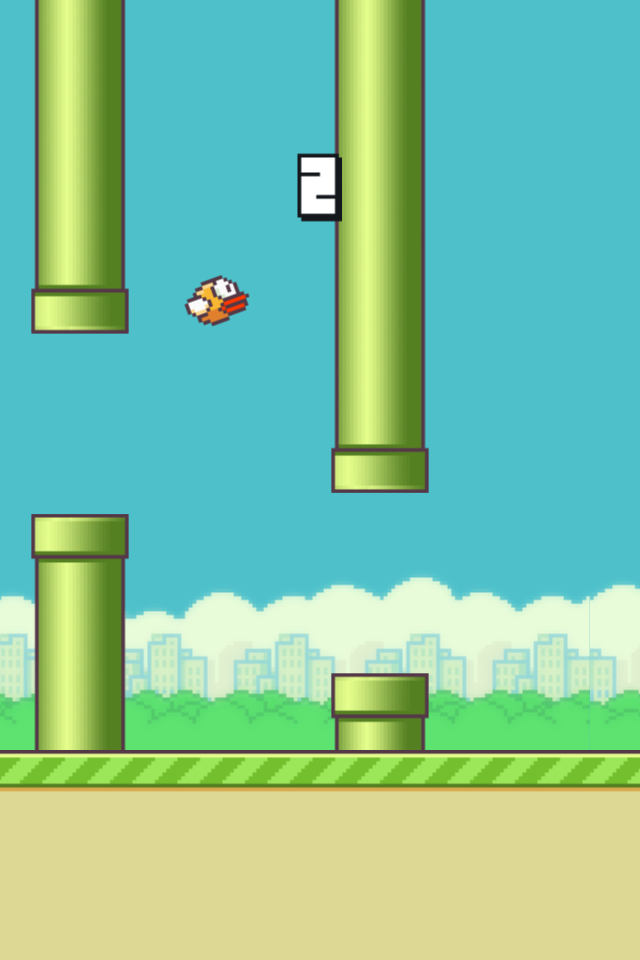
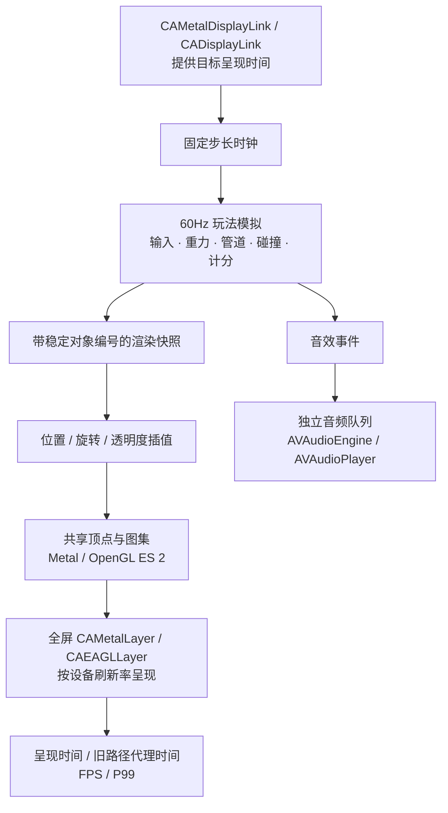

<div align="center">
  

# Flappy Bird · arm64 + Metal

**Flappy Bird 1.2 原生迁移：现代设备使用 arm64 + Metal，兼容分支将 armv7 + OpenGL ES 2 纳入同一个 IPA，目标覆盖 iOS 5–27。**

A native Flappy Bird 1.2 revival: arm64 + Metal for modern iOS, with an experimental armv7/OpenGL ES 2 path in the same IPA.

[](https://github.com/Pingfan1337/FlappyBird-arm64-Metal-iOS27/actions/workflows/build.yml)


[下载兼容测试版](https://github.com/Pingfan1337/FlappyBird-arm64-Metal-iOS27/releases/tag/v1.1.0-compat.1) · [安装方法](#安装) · [从源码构建](#从源码构建) · [流畅度改造](#流畅度改造) · [已知限制](#已知限制)

</div>

> **兼容测试分支 / build 12006。** 单 IPA 已完成双架构构建与静态兼容审计，目标覆盖 iOS 5–27；这不等于所有系统、机型已经实测。下一台旧设备测试目标为 **iPhone 4S / iOS 6.1.3（已越狱）**。之前在 iPhone 17 Pro Max 上确认流畅的是 build 12005，新通用包也需要复测。[稳定版 v1.0.0](https://github.com/Pingfan1337/FlappyBird-arm64-Metal-iOS27/releases/tag/v1.0.0) 保持可下载。

## 画面预览

<table>
  <tr>
    <td align="center"><br /><b>菜单</b></td>
    <td align="center"><br /><b>准备起飞</b></td>
  </tr>
  <tr>
    <td align="center"><br /><b>游戏中</b></td>
    <td align="center"><br /><b>结算</b></td>
  </tr>
</table>

以上图片由仓库中的**同一套游戏逻辑、Metal 着色器与渲染几何**在 Mac GPU 上离屏生成，使用实际模拟状态；游戏画面由自动输入推进。图片不含 iPhone 的动态岛、系统手势条与原生 FPS 标签，也不作为真机帧率证明。可用 `python3 scripts/previews.py` 重新生成。

## 项目简介

本项目的核心是 **64 位兼容、Metal 原生渲染和 iOS 27 适配**。以旧版 32 位 Flappy Bird **1.2** 的资源和可分析程序为依据，重建玩法逻辑，生成现代 iPhone 可运行的 **arm64 原生应用**，并用现代 Apple 框架实现显示、音频与系统入口。

| 迁移重点 | 当前实现 |
|---|---|
| 32 位 → 64 位 | 从旧版 ARMv7 程序分析并重建为 arm64 应用 |
| 原生渲染 | 支持 Metal 的 arm64 设备用 Metal；旧设备用 OpenGL ES 2 |
| 目标系统 | 单 IPA 目标覆盖 iOS 5–27 |
| 实际二进制下限 | armv7：iOS 5；arm64：iOS 7；真机矩阵待补齐 |

高刷新率、全屏布局和低延迟音频是现代化体验的一部分。

项目经过了几轮真机反馈：先打通启动和签名安装，再修复全屏黑边、地面遮挡、顶部高度限制，最后处理“FPS 很高，运动却仍有顿挫”的问题。稳定版为 **12005**；本兼容候选为 **12006**。

项目作者在 **iPhone 17 Pro Max / iOS 27** 环境确认 build 12005 可运行且流畅。build 12006 的主机回归、双架构编译与依赖审计通过，旧设备和现代设备的这次构建均待真机反馈。

### 当前功能

| 功能 | 实现情况 |
|---|---|
| 原版素材 | 原始图集、图集索引、五个音效；构建前逐文件校验 SHA-256 |
| 游戏流程 | 菜单、准备、点击飞行、管道、碰撞、计分、死亡、结算与重开 |
| 成绩 | 本地最高分与原版奖牌门槛 |
| 设备架构 | 同一 Mach-O 内含 armv7 / iOS 5 与 arm64 / iOS 7 |
| 显示 | Metal 或 OpenGL ES 2 原生分辨率绘制；现代 ProMotion 设备最高请求 120Hz |
| 玩法模拟 | 固定每秒 60 次；显示刷新率变化不会让游戏加速 |
| 全屏适配 | 等比保留核心区域，上下延伸天空和地面 |
| 顶部飞行 | 可完全飞出视野；有限上升，自然回落后可再次起跳 |
| 音频 | iOS 8+ 预解码 + 三个引擎节点；旧系统预加载 AVAudioPlayer；均在音频队列调度 |
| 性能读数 | 渲染后端、FPS 与 P99；现代 Metal 用实际呈现时间，旧路径为代理统计 |

## 单 IPA 的兼容路径

| 硬件 / 系统 | 渲染 | 帧调度 | 音效 |
|---|---|---|---|
| armv7，目标 iOS 5–10 | OpenGL ES 2 | CADisplayLink | iOS 5–7：AVAudioPlayer；iOS 8+：AVAudioEngine |
| arm64，目标 iOS 7 | OpenGL ES 2 | CADisplayLink | AVAudioPlayer |
| arm64，目标 iOS 8–16 | 可用时 Metal，否则 GLES2 | CADisplayLink | AVAudioEngine |
| arm64，目标 iOS 17–27 | 可用时 Metal，否则 GLES2 | Metal 路径用 CAMetalDisplayLink | AVAudioEngine |

`CAMetalDisplayLink` 是现代系统的优选路径，不是应用启动的必要条件。Metal 框架和新系统类使用弱链接与运行时检查；32 位切片根本不链接 Metal。iOS 13 以下通过 AppDelegate 创建窗口，现代系统使用 Scene。老系统有原版启动图与图标，iOS 8+ 带编译后的启动 storyboard，保持原生屏幕尺寸入口。

两套后端共享逻辑、顶点、图集、布局和运动插值，继续保留全屏地面遮挡、屏幕外飞行及固定 60Hz 玩法。未恢复旧游戏引擎，兼容路径也没有改回 30FPS 模拟。

<p align="center"><br />4S 尺寸（640×960）的桌面 OpenGL 离屏检查图；不是手机截图。</p>

“全机型”仍是验证目标。签名工具是否保留两个切片、老系统安装环境、iPad 布局以及每个系统的驱动行为，都需要分别实测；不把降低 Info.plist 版本号当作兼容证明。

## 安装

### 下载 Release

1. 打开 [兼容测试版 v1.1.0-compat.1](https://github.com/Pingfan1337/FlappyBird-arm64-Metal-iOS27/releases/tag/v1.1.0-compat.1)。
2. 下载 **`FlappyBird-iOS5-27-Universal-unsigned.ipa`**。新旧设备使用同一个文件。
3. 现代 iPhone：用自己的证书和描述文件重新签名，例如轻松签；关闭工具的“移除不需要的架构 / 瘦身”选项，以保留 armv7 和 arm64。
4. 越狱旧设备：通过该设备已有、支持其系统版本的 IPA 安装与签名环境安装同一个包。越狱本身不保证未签名包能直接安装；签名验证错误和启动崩溃需要分别排查。
5. 打开 Flappy Bird，先检查菜单、起飞、管道、音效、死亡、重开和前后台恢复。右上角应显示当前后端 `GLES` 或 `Metal`。

**IPA 未签名。** 仓库和发布包不含证书、私钥或描述文件；构建兼容性与签名兼容性是两项独立检查。

下载后可在文件所在目录校验：

```bash
shasum -a 256 -c FlappyBird-iOS5-27-Universal-unsigned.sha256
```

本次候选保留原版 bundle identifier，与同标识的其他版本可能发生覆盖或安装冲突。稳定现代版仍可从 [v1.0.0](https://github.com/Pingfan1337/FlappyBird-arm64-Metal-iOS27/releases/tag/v1.0.0) 下载。

### 操作

- 点击开始按钮进入准备状态，再点击屏幕起飞。
- 游戏中点击屏幕让小鸟上升。
- 死亡后等待结算，点击开始按钮重开。
- **双指双击**切换右上角 FPS / P99 标签。

### 关于 120Hz

“最高 120Hz”是应用的渲染请求，实际刷新率由系统、显示器和运行状态共同决定。[Apple 的 ProMotion 说明](https://developer.apple.com/documentation/quartzcore/optimizing-iphone-and-ipad-apps-to-support-promotion-displays)也明确区分了帧率偏好与最终调度。

Metal / iOS 10.3+ 的 FPS 来自 drawable 的实际呈现回调；早期 Metal 使用 GPU 完成时间，GLES 使用 `presentRenderbuffer` 返回时间，属于代理统计，不能当作实际扫描输出帧率。**P99** 是最近最多 256 个记录到的帧间隔的 99 分位数，单位为毫秒。稳定 120Hz 的帧间隔约为 **8.33ms**；观察 P99 能发现平均 FPS 掩盖的偶发长帧。前台恢复后会重新统计。

## 从源码构建

### 环境

- macOS。
- 完整 Xcode，且已接受许可、安装 iPhoneOS SDK。
- 支持 iOS 17 API、且仍能生成 armv7 目标的 clang / ld（本机构建使用 Xcode 27.2）。
- Python 3.12+。

**不需要下载 iOS 模拟器运行时，也不需要安装第三方 Python 包。** 构建脚本使用 Xcode 的 clang 与当前 iPhoneOS SDK；默认通用构建首次还会下载约 8MB 的固定版本旧 SDK / C++ 头文件，缓存于 `build/toolchains/`。下载需联网并校验 SHA-256。

```bash
git clone --branch compatibility/ios5-universal https://github.com/Pingfan1337/FlappyBird-arm64-Metal-iOS27.git
cd FlappyBird-arm64-Metal-iOS27

# 确认设备 SDK
xcrun --sdk iphoneos --show-sdk-path

# 执行主机回归检查
python3 scripts/test.py

# 构建单 IPA：armv7 + arm64
python3 scripts/build.py

# 检查真实 Mach-O 架构、系统下限、入口、弱链接及原版资源
python3 scripts/audit_ipa.py
```

生成结果：

```text
dist/
├── FlappyBird-iOS5-27-Universal-unsigned.ipa
├── FlappyBird-iOS5-27-Universal-unsigned.sha256
└── compatibility-audit.json
```

默认中间产物放在 `build/device/`，可用 `FLAPPY_BUILD_DIR` 指定其他构建目录。`build/` 和 `dist/` 已加入 `.gitignore`。当前工程使用脚本构建，无需打开 `.xcodeproj`。

构建脚本会验证 `resources/sha256.json`，生成传统 FAT32 Mach-O、armv7 的 iOS 5 入口和 arm64 的 iOS 7 入口；不使用旧 dyld 不支持的 chained fixups。bundle 的最低版本为 iOS 5，不要求 arm64 或 Metal 能力。最终签名由使用者完成。

只构建现代 iOS 17+ arm64 版本、不下载旧工具链时：

```bash
python3 scripts/build.py --modern-only
# dist/FlappyBird-iOS17-arm64-unsigned.ipa
```

旧工具链来自 [Theos SDK 集合](https://github.com/theos/sdks) 的固定 iPhoneOS 9.3 归档和 [LLVM libc++ 3.7 历史源码](https://github.com/llvm-mirror/libcxx/tree/de80a7d886d75188de210eb4d6f0768fdc4d4d0b)。精确 URL、提交和哈希见 `scripts/legacy_toolchain.py`。脚本仅在本地缓存中规范化设备 TBD 架构、补全内存函数导出元数据、恢复 iOS 5 的 NSObject / C++ 符号提供库，并修正旧头文件与现代 clang 的异常规格兼容；不修改系统 SDK，也不将 SDK 打入 IPA。Apple SDK 和 LLVM 文件适用各自上游条款。

### 重新生成文档配图

```bash
python3 scripts/previews.py
```

这一步需要可用的本机 Metal GPU，会更新 `docs/images/` 中的四张 PNG；它不启动模拟器，也不录制手机屏幕。

## 流畅度改造

### 为什么 FPS 很高也可能不顺滑？

平均帧率只能说明一段时间内呈现了多少帧。物体在相邻帧之间匹配错误、位移不连续，或者呈现间隔不均匀，都可能造成顿挫。

项目中曾复现一个具体问题：管道队列循环后，插值按同名精灵在列表里的“第几个”匹配上一帧；同一根管道会被匹配到别的对象。一次 120Hz 中间帧测试中，期望横坐标为 `104`，旧代码绘制为 `103`，造成 **1 个逻辑像素的跳变**。

修复后的每对管道有持续不变的对象编号。队列循环时保留存活对象的编号，同时保留第三对屏幕外管道的渲染快照，让进入视口的运动也可以连续插值。

| 检查 | 修复前 | 当前版本 |
|---|---:|---:|
| 指定管道循环中间帧 | `x = 103` | `x = 104` |
| 该帧期望位置 | `x = 104` | `x = 104` |
| 该帧位置误差 | `−1 px` | `0 px` |
| 连续运动检查 | — | 固定与变刷新率各 4000 帧 |

8000 帧测试中的最大位置误差约为 `1.14e-10` 个逻辑像素。这是对应测试轨迹的结果，不能直接推导为所有真机场景都没有卡顿。

### 当前链路



关键改动：

- **现代 Metal 调度**：`CAMetalDisplayLink` 直接提供 drawable，动画时钟使用 `targetPresentationTimestamp`；GPU 命令提交后按其合同调用 `present()`。[呈现 API 文档](https://developer.apple.com/documentation/quartzcore/cametaldisplaylinkdelegate/metaldisplaylink(_:needsupdate:))
- **原生分辨率**：直接绘制到屏幕 drawable，避免新增插值帧被低分辨率中间画布重新量化。
- **缓冲复用**：三个预分配顶点缓冲、一个渲染 pass，显示回调不等待 GPU 完成。
- **稳定对象身份**：管道循环和小鸟换翼帧不会中断运动插值。
- **独立音频调度**：五个音效预解码为统一的 44.1kHz 双声道 float PCM，经三个 `AVAudioEngine` 播放节点调度。显示线程不再执行音效文件进度复位。[音频节点文档](https://developer.apple.com/documentation/avfaudio/avaudioplayernode)
- **兼容调度**：旧系统使用 CADisplayLink，保持同一固定步长与插值；音频 API 随系统降级，播放调用留在音频队列。
- **可观测性**：显示后端、FPS / P99；现代 Metal 统计真实呈现时间，早期路径使用代理时间。

### 保留的玩法与有意适配的部分

| 项目 | 当前逻辑 |
|---|---|
| 核心画布 | 288 × 512 逻辑坐标 |
| 小鸟碰撞框 | 20 × 20 |
| 起跳速度 | `−5.0f` / 模拟 tick |
| 起跳后重力 | `0.3f` / 模拟 tick |
| 下降速度上限 | `8.0f` / 模拟 tick |
| 地面边界 | 核心坐标 `y = 400` |
| 管道宽度 / 间隙 | 52 / 96 |
| 管道移动 | 每模拟 tick 2 个逻辑像素 |
| 奖牌门槛 | 10 / 20 / 30 / 40 分 |

全屏版保留核心区域的比例，并延伸天空和地面。顶部起跳截止线按实际视野上边界重新计算，小鸟可以完整飞出屏幕，在有限上升后自然回落；上管道的轴和碰撞范围随之向上延伸。地面以原有前景顺序遮住下方管道。

在 4S 的 3:2 屏幕和 iPad 的 3:4 屏幕上，背景城市与地面纹理向左右平铺延伸，玩法物体的位置和大小保持不变。

这些是面向不同屏幕的适配。项目仍在还原和验证中，不宣称与原版逐像素、逐帧完全等价。

## 测试与验证

```bash
python3 scripts/test.py
```

当前回归覆盖：

| 测试 | 主要内容 |
|---|---|
| `OriginalBirdChecks` | 起跳轨迹、整数截断、旋转、落地与碰撞边界 |
| `OriginalGameChecks` | 菜单 → 准备 → 飞行 → 死亡 → 结算 |
| `PresentationChecks` | 不同刷新率下模拟一致性、插值、换翼、地面循环、触摸映射与遮挡 |
| `FlightCeilingChecks` | 完整飞出视野、有限上升、自然回落、重开与上管道防绕行 |
| `MotionContinuityChecks` | 8000 帧管道连续位移与 FPS / P99 统计 |
| `AudioDecodeChecks` | 五个原始音效的加载、PCM 格式、声道及非零音频能量 |

armv7 的全部 **200 个强导入符号**另与 iOS 5.0 SDK 的对应提供库（含重导出）核对通过，9 个新系统弱导入不作旧系统必需项。arm64 的 155 个强导入也与 iOS 7.1 SDK 对应库核对通过；这项补充检查没有验证 iOS 7.0 运行。审计还固定检查 NSObject 和部分 C++ 符号的历史库归属，避免现代 SDK 引入错误的双级命名空间绑定。

持有对应历史 SDK 时，可自行复核导出与重导出（脚本不下载 SDK）：

```bash
python3 scripts/audit_sdk.py --sdk /path/to/iPhoneOS5.0.sdk \
  --binary build/device/FlappyBird-armv7 --arch armv7
```

兼容候选另完成 armv7 / arm64 编译、IPA 完整性、原资源哈希、传统 dyld 入口与弱依赖审计。桌面 GPU 分别按现代屏幕与 4S 尺寸，使用同一套 GLSL / Metal 着色器和绘制数据做离屏对比：平均通道差约 `0.000011`、最大差 `1/255`，没有通道差超过 `2/255`，地面遮挡像素检查通过。**桌面 OpenGL 结果不能证明 iPhone 的 OpenGL ES 驱动已经通过测试。**

可在有本机 GPU 的 Mac 上复现：

```bash
xcrun clang++ -std=c++17 -O2 -fobjc-arc -Wno-deprecated-declarations \
  -framework Foundation -framework CoreGraphics -framework ImageIO \
  -framework OpenGL -framework Metal scripts/check_renderers.mm -o build/check_renderers
./build/check_renderers
./build/check_renderers --legacy-4s
```

输出 `build/compat-opengl.png` 和 `build/compat-metal.png`；4S 检查输出对应的 `compat-4s-*.png`。`scripts/audit_ipa.py` 的报告明确标记旧设备执行待测；它检查一组已知新 API 与实际链接信息，不能穷尽所有系统运行行为。

主机测试和离屏渲染不能替代真机验证。当前真机反馈来自项目作者的使用体验，尚无覆盖所有设备、温控、音频路由与长时间运行场景的测试报告。

GitHub Actions 会执行主机回归、双架构未签名 IPA 构建及兼容审计，不在 CI 中运行 GPU 脚本。

## 目录

```text
.
├── src/
│   ├── App/       # 双入口、Metal / GLES2 呈现、几何、着色器、音频
│   └── Core/      # 玩法、固定步长、插值、布局和帧间隔统计
├── resources/     # 原版图集、音效、图标和 SHA-256 清单
├── tests/         # 主机回归检查
├── scripts/       # 构建、测试和 GPU 配图脚本
├── docs/images/   # 实际渲染器生成的文档配图
├── CHANGELOG.md
└── NOTICE.md
```

## 已知限制

- **Game Center**：原开发者的排行榜无法通过本项目的独立签名身份接入；点击排行榜会说明当前限制。
- **广告与商店链接**：原广告服务没有迁移；商店按钮仍指向原应用链接，其可用性不由本项目保证。
- **还原细节**：奖牌闪烁粒子尚未完成；现代渲染器与旧版多级缩放的逐像素采样可能不同。
- **帧率**：最高请求 120Hz，系统最终呈现频率仍可能变化。
- **设备覆盖**：build 12006 的 iPhone 4S / iOS 6.1.3 和 iPhone 17 Pro Max 复测待完成；iOS 5、其他中间版本及 iPad 尚未实测。
- **签名覆盖**：同一 IPA 可含两种架构，但不同系统接受的证书、哈希和安装工具也需要匹配；此测试包没有附带统一签名。

## 反馈问题

欢迎通过 [Issues](https://github.com/Pingfan1337/FlappyBird-arm64-Metal-iOS27/issues) 提交问题。建议附上：

- iPhone 型号、iOS 版本、应用构建号。
- 从启动到问题出现的复现步骤。
- 相关截图或录屏；涉及顿挫时附上 FPS / P99 读数。
- 是否与某个动作、场景切换、前后台切换或音频路由有关。

请勿在 Issue 中上传证书、密码、私钥或描述文件。

## 致谢与权利说明

原版游戏、像素画面、音效和相关品牌归原权利人所有，向 [.GEARS / DOTGEARS](https://dotgears.com/) 致谢。本项目为非官方迁移，与原开发者或 Apple 没有关联。

公开仓库不等于授予原版素材或重建代码新的使用许可。本项目没有将原版资源置于 MIT、Apache 或公有领域；具体范围见 [NOTICE.md](NOTICE.md)。

仓库不包含原始 App Store IPA、购买元数据、个人路径、签名材料或私人 IDA 数据库。兼容 Release 提供的是重建后的 armv7 + arm64 应用。
